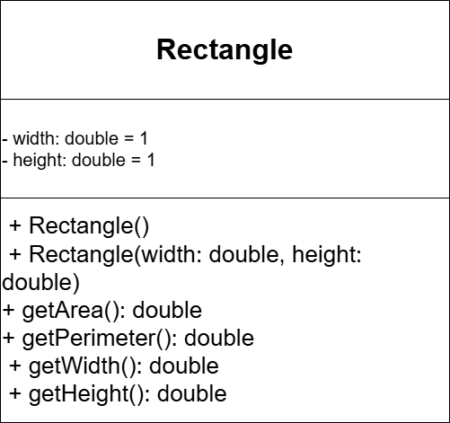
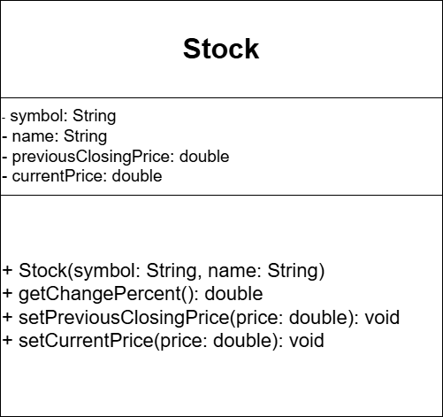

# Java Hafta 1 Ödevleri (Bölüm 9)

Bu proje, Nesne Yönelimli Programlama (OOP) dersi kapsamında hazırlanan Bölüm 9.1 ve 9.2 ödevlerini içermektedir.

---

## 📌 1. Bölüm 9.1: Rectangle Class (Dikdörtgen Sınıfı)

Genişlik ve yükseklik değerlerine göre dikdörtgenin alanını ve çevresini hesaplayan sınıftır.

### UML Diyagramı

---

## 📌 2. Bölüm 9.2: Stock Class (Hisse Senedi Sınıfı)

Hisse senedinin sembolü, adı ve fiyat hareketlerine göre değişim yüzdesini hesaplayan sınıftır.

### UML Diyagramı
